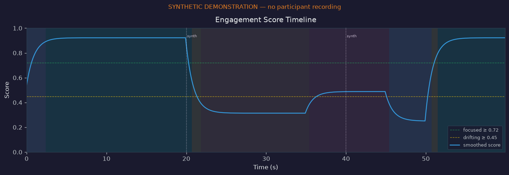

# Multimodal Response Lab

[](https://github.com/nealyx/multimodal-response-lab/actions/workflows/offline.yml)

A local research prototype for recording webcam-derived eye and head signals, running timed visual experiments, and exploring saved sessions. The useful engineering work is the complete path from signal processing to inspectable events, reusable analytics, and a report someone else can reproduce.

**Start with the synthetic demo below.** It exercises the real scoring, export, loading, and reporting code without a camera, microphone, model download, or participant data.

The historical names `EngagementScore`, `focused`, `distracted`, and `fatigued` are heuristic API labels. **They do not establish cognition, emotion, attention, fatigue, comprehension, or productivity.** Confidence is a separate quality heuristic, not a probability that a label is correct.

[Architecture and formulas](docs/architecture.md) · [Validation record](docs/validation.md) · [Configuration](configs/default.yaml) · [Tests](tests/)



## Try it without a camera

Python **3.12** is verified locally and in the [Linux/macOS offline CI checks](docs/validation.md#continuous-checks). Run from the repository root:

```bash
git clone https://github.com/nealyx/multimodal-response-lab.git
cd multimodal-response-lab
python3.12 -m venv .venv
source .venv/bin/activate
python -m pip install -r requirements-offline.txt
python demo_offline.py
```

On Windows, activate with `.venv\Scripts\activate` instead. That activation syntax is provided for convenience; Windows execution has not been validated here.

Open `outputs/demo/reports/synthetic-orientation-v1/report.html` in your browser. The report embeds its charts and requires no server. The command creates:

```text
outputs/demo/
├── demo_manifest.json                         # synthetic provenance and expected counts
├── session/
│   ├── session_log.json                       # scripted events, config, and trial summaries
│   ├── samples.csv                            # 600 synthetic signal snapshots
│   └── events.csv
└── reports/synthetic-orientation-v1/
    ├── report.html                            # conspicuous synthetic-data notice
    ├── session_metrics.json
    ├── timeline.csv
    └── charts/                                # five PNG charts
```

The fixture represents 60 simulated seconds at 10 samples/second: warmup, centered inputs, off-center inputs, a closure flag, missing face data, then recovery. Its two scripted key latencies are **350 and 450 ms**. These are chosen inputs, not observations or performance measurements. The input session is deterministic; report generation timestamps vary between runs.

The demo refuses to overwrite an existing output directory. Use `python demo_offline.py --output-dir outputs/demo-2` to run it again.

## What is implemented

| Workflow | Entry point | What it does |
|---|---|---|
| Synthetic walkthrough | [`demo_offline.py`](demo_offline.py) | Controlled analyses → actual scorer → JSON/CSV → charts/HTML |
| Live orientation dashboard | [`run_attention_test.py`](run_attention_test.py) | MediaPipe landmarks, EAR/blink FSM, solvePnP head pose, iris-ratio gaze, weighted proxy |
| Timed visual experiments | [`run_stimulus_experiment.py`](run_stimulus_experiment.py) | Color, shape, moving-target, and key-prompt trials; event and sample exports |
| Saved-session reports | [`analyze_session.py`](analyze_session.py) | Distribution summaries, event-relative changes, timelines, and HTML |
| Personal baseline and survey | [`run_calibration.py`](run_calibration.py) | Records a baseline profile or collects retrospective session ratings |
| Behavioral feature exploration | [`embed_session.py`](embed_session.py) | 18 hand-engineered window features, PCA, K-Means, anomaly flags |
| Supervised baselines | [`train_behavior_model.py`](train_behavior_model.py) | Classifiers with heuristic or survey labels and reported split metrics |
| Multi-session catalog | [`build_dataset.py`](build_dataset.py) | Participant/session registry, data checks, catalog statistics, exports |

Calibration is implemented: profile collection, derived baseline values, survey labels, and offline comparisons. **The live scorer does not automatically load a profile or apply personalized thresholds.** Screen-coordinate gaze calibration is also not implemented. See [calibration boundaries](docs/architecture.md#calibration-and-learning).

## Understand the score

With the default configuration:

```text
raw_score = 0.50 × gaze_score + 0.20 × head_score + 0.30 × eye_score
smoothed_score = 0.10 × raw_score + 0.90 × previous_score
confidence = history_warmup × gaze_quality × pose_quality
```

The score is a **weighted sum**, while confidence is a separate product. Gaze already uses head-pose information, and missing iris data can fall back to the head channel; these channels are not independent evidence.

Confidence is zero when the caller reports no face. A numeric score can still exist because missing head/eye components use neutral values and the EMA retains history. State labels require five consecutive candidate frames, including transitions to `unreliable`; use current confidence and availability rather than a possibly stale badge alone. Confidence does not fully represent every missing-channel combination.

A low score describes the configured proxy. It does not establish distraction. A high score does not establish attention. The [architecture](docs/architecture.md) explains the component formulas, timing, fallback behavior, and remaining limits.

## Work with saved sessions

The offline installation supports these commands without a vision model:

```bash
# Reanalyze the generated session using the normal report CLI
python analyze_session.py outputs/demo/session --output-dir outputs/reanalysis

# Derive window features and inspect clusters (not discovered mental states)
python embed_session.py outputs/demo/session --output-dir outputs/embeddings

# Inspect dataset-management and baseline-training commands
python build_dataset.py --help
python train_behavior_model.py --help
```

Pass a **session directory** to load both events and `samples.csv`. Passing `session_log.json` alone deliberately omits sample-based analytics. `analyze_session.py --profile path/to/user_profile.json` additionally prints an offline baseline comparison.

The supervised path defaults to labels calculated from the same signals used as features. Its metrics then describe reproduction of those rules, not independent prediction of a cognitive state. Survey labels reduce this particular circularity but remain subjective. Overlapping windows are correlated, and current random/temporal split options do not provide a participant-held-out evaluation. No real-world predictive accuracy is claimed.

## Optional live capture

Use a **separate** environment for GUI-enabled OpenCV; do not mix `opencv-python`, `opencv-python-headless`, and other OpenCV wheels in one environment.

```bash
python3.12 -m venv .venv-live
source .venv-live/bin/activate
python -m pip install -r requirements-live.txt
python run_attention_test.py
```

`FacePipeline` fetches the MediaPipe face-landmarker model from Google's model host if `.cache/models/face_landmarker.task` is missing. That initial download needs internet access; the live scripts process frames locally afterward. The model URL uses `latest`, so archive the model hash alongside any experiment that needs exact reproduction. No model was downloaded or live camera tested for the latest [validation pass](docs/validation.md).

The dashboard and experiment accept `--device`, `--backend`, `--config`, and `--debug`. The default backend in `configs/default.yaml` is macOS `avfoundation`; Linux users can select `--backend v4l2` or `--backend any`. Press Q or Esc to exit. `run_attention_test.py --demo` is a cleaner **live camera overlay**, not the synthetic walkthrough.

```bash
python run_stimulus_experiment.py --experiment configs/experiment_default.yaml
python run_calibration.py --duration 30
python run_calibration.py --survey outputs/sessions/<session_id>/
```

Camera access requires the operating system's permission. If the wrong camera opens, choose the device index explicitly. The separate layer scripts (`run_face_test.py`, `run_blink_test.py`, `run_head_pose_test.py`, `run_gaze_test.py`) help isolate capture or signal problems.

## Verification

For the full offline suite, use a fresh test environment:

```bash
python3.12 -m venv .venv-test
source .venv-test/bin/activate
python -m pip install -r requirements-test.txt
python -m pytest tests/ -q
```

The tests exercise synthetic landmarks/arrays, state machines, scoring, file round trips, reports, calibration, features, classifiers, and catalog management. They do not open a camera or display, download models, or validate a person's state. An end-to-end demo test blocks imports of the camera/ML hardware stack and network access, checks generated artifacts, and verifies overwrite protection.

[Offline CI](.github/workflows/offline.yml) runs the full suite and a separate minimal-dependency demo/report/feature walkthrough on Linux and macOS with Python 3.12. Each job creates a fresh environment. After dependencies are installed, a Python socket guard rejects network calls; the minimal job also rejects optional vision/audio imports. This checks the offline software path, not live hardware or scientific accuracy.

The [dated validation record](docs/validation.md) lists actual results and dependency versions. Historical 285-test and 25–30 FPS badges have been removed: test counts had drifted, and this repository does not provide a reproducible live-throughput benchmark. Successful software tests are not accuracy validation.

## Interpretation and data boundaries

- Webcam iris ratios are coarse geometry proxies, not calibrated screen coordinates. No angular-accuracy benchmark is included.
- Lighting, occlusion, glasses, camera placement, anatomy, and additional monitors can change the signals. Default thresholds are engineering defaults, not established population norms.
- Application timestamps do not measure photon onset or exact sensor exposure. Camera/display delay, polling, frame drops, EMA, and debounce affect observed latency. Event-relative differences alone do not establish causation.
- Exports contain **per-frame** values and event timestamps, not only aggregates. Calibration and surveys add personal baselines and self-reports. These files can be sensitive even without video.
- The normal session exporter writes no image/video frames, but optional debug utilities can save frames. Do not commit recordings, survey responses, profiles, or participant manifests; generated outputs are ignored by Git.
- Collection from another person needs their informed participation. These heuristic outputs do not support clinical, hiring, productivity, or ability judgments.

## Useful next work

1. Establish a consented, independently labeled evaluation with participant/session separation and non-overlapping test windows.
2. Measure actual capture-to-render timing and signal quality under documented conditions before quoting FPS or latency precision.
3. Decide how baseline profiles should affect live thresholds, then evaluate the change rather than assuming calibration improves accuracy.
4. Make missing-channel quality and debounced display states easier to inspect in the live interface.

This repository currently has no license grant. Adding or changing licensing is a separate maintainer decision.
