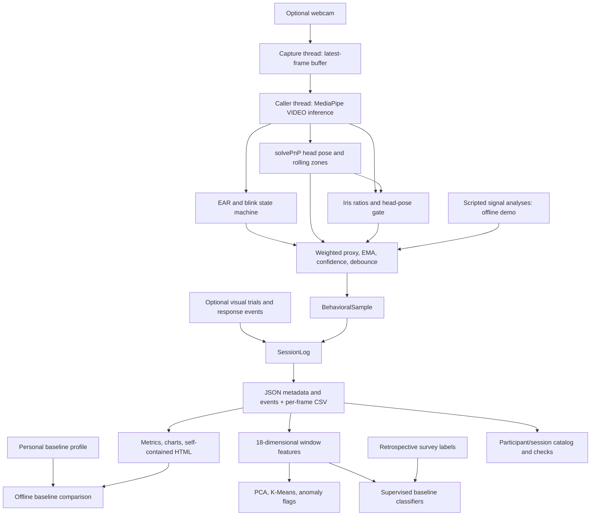

# Architecture and interpretation

This is a local signal-processing and experiment-tooling prototype. Its labels describe configured heuristics. The code does not establish cognition, emotion, attention, health, or real-world predictive accuracy.

## Data flow



`demo_offline.py` enters at scripted signal analyses. It exercises the actual `AttentionScorer`, session exporter, loader, analytics, and report renderer. It does **not** test camera capture, face detection, geometric estimation, the blink detector's extraction accuracy, or observed reaction times. All generated artifacts retain synthetic provenance.

## Scoring and confidence are different

[`AttentionScorer`](../src/signals/engagement.py) receives typed `BlinkAnalysis`, `AttentionAnalysis`, and `GazeAnalysis` objects. With the checked-in defaults:

| Component | Calculation |
|---|---|
| Gaze | `on_screen_fraction` when reliable; otherwise `0.65 × head.attention_fraction` if head data exists, else zero |
| Head | `attention_fraction × (1 − min(0.5, (yaw_std + pitch_std)/30))`; missing input uses 0.5 |
| Eye | Mean openness, multiplied by 0.15 for prolonged closure **or** 0.35 for drowsiness; additional 0.80/0.85 low/high-rate factors; clamped to [0,1]; missing input uses 0.5 |
| Raw proxy | `0.50 × gaze + 0.20 × head + 0.30 × eye` |
| Smoothed proxy | `alpha × raw + (1 − alpha) × previous`, initially 0.5; default `alpha=0.10` |

The default weights sum to one. The implementation does not automatically normalize arbitrary custom weights. Gaze and head share information, so their noise is not established to be independent.

Confidence is a separate heuristic:

```text
if face_detected is false: confidence = 0
otherwise:
  history = min(1, elapsed_since_first_update / min_history_s)
  gaze_quality = 1 when iris is reliable, otherwise 0.75
  pose_quality = 1 − min(0.3, max(0, reprojection_error − 0.5*error_max)/error_max)
  confidence = history × gaze_quality × pose_quality
```

A nonpositive `min_history_s` disables warmup. When head data is absent, pose quality defaults to one; confidence also does not separately penalize a missing blink channel. This is a quality indicator with known gaps, **not calibrated uncertainty**. Elapsed warmup time is not a count of continuously valid frames.

Classification considers face availability and minimum confidence first, then closure/drowsiness flags, then score thresholds. Every new state—including `unreliable`—must persist for the configured number of frames (default five). Current confidence may be zero while the displayed badge still contains the previous state. Consumers should inspect both.

At `alpha=0.10`, the EMA half-life is `log(0.5)/log(0.9) ≈ 6.58 processed frames`, or about 0.263 s at 25 FPS. It is not a fixed wall-clock filter. Five-frame debounce and irregular frame arrival add further delay. Rolling fractions count stored frames within a time window rather than integrating elapsed time.

## Capture and timing

[`FacePipeline`](../src/pipelines/face_pipeline.py) has a background **capture** thread and a latest-frame buffer. `process_latest()` performs synchronous MediaPipe VIDEO inference on its calling thread; there is no independent background inference worker. The default model is downloaded only if absent.

The live pipeline stamps buffer writes and processing completion with `time.perf_counter()`. The experiment establishes start/end values with `time.monotonic()` and supplies processed-frame timestamps to its presenter and recorder. These are application-clock timestamps; an assumption that the clock origins are compatible must be checked on a target runtime. They do not independently measure exposure time or display-photon onset. Synthetic sessions use explicitly labeled relative seconds instead.

Visual onset is recorded when the presenter activates/renders an event. Key handling and behavioral changes are polled by the main loop. `response_ts − onset_ts` therefore includes software and device timing effects. EMA/debounce affect signal-state response events differently from key events. No live timing benchmark or fixed ±33 ms precision is established here.

## Session files and reports

[`src/stimulus/events.py`](../src/stimulus/events.py) defines the shared dataclasses. [`SessionExporter`](../src/stimulus/exporter.py) writes:

- `session_log.json`: configuration, session metadata, stimulus/response events, optional trial summaries.
- `samples.csv`: one row per processed frame, including score, confidence, gaze ratios, head angles, blink metrics, and state.
- `events.csv`: merged stimulus/response events.

`load_session_dir()` reads JSON plus samples. `load_session_json()` reads only JSON and therefore has no per-frame samples. The loader is tolerant of extra fields and skips malformed records with warnings; it is not a strict provenance validator.

`SessionReporter` computes aggregate signal summaries, heuristic state fractions, key-response latencies, and event-relative baseline/during/recovery comparisons. A lower during-event score is a descriptive association, not proof that the event disrupted attention. Some statistics include unreliable frames and placeholder signal values; inspect confidence and the exported timeline before drawing conclusions.

HTML embeds charts as PNG data URLs and makes no CDN/font requests. Synthetic provenance in `config.provenance.synthetic` adds a conspicuous notice. `generated_at` uses UTC wall time only for report metadata, not event latency.

The reporting/event path does not require OpenCV or MediaPipe. Package-level rendering exports are imported lazily, and a pose type annotation does not pull the native vision stack into the pure scorer. Rendering and geometric-estimation tests still use OpenCV on synthetic arrays.

## Calibration and learning

[`run_calibration.py`](../run_calibration.py) supports two distinct workflows:

- **Baseline recording:** collect raw values and save a `UserProfile` with EAR, blink-rate, orientation, gaze, and proxy-score summaries. Profile convenience properties expose candidate personalized thresholds.
- **Survey:** collect retrospective session ratings and save survey/label files without opening a camera.

`analyze_session.py --profile ...` prints comparisons against that profile. The live dashboard and scorer do not automatically load a profile or modify their thresholds. Baseline recording is also not calibrated mapping from gaze ratios to screen coordinates.

[`src/embedding/`](../src/embedding/) computes 18 hand-engineered features from overlapping windows. PCA plots, clusters, and anomaly flags describe those features; they do not discover or validate mental-state categories.

[`src/supervised/`](../src/supervised/) trains baseline classifiers with heuristic labels or survey labels. Heuristic labels are circular when derived from their own predictor features. Surveys provide a different source but may assign a single subjective rating to every window in a session. Current splitting offers random or ordered temporal splits, without a participant-held-out split or a purge gap for overlapping windows. Reported classifier scores must remain scoped to that evaluation.

[`src/dataset/`](../src/dataset/) catalogs participants, sessions, optional profiles, labels, and embeddings. It is local file management, not a claim of a published participant dataset.

## Reproducibility boundary

- Use the synthetic fixture to check software behavior without collecting anyone's data.
- Record source revision, Python/dependency versions, config, model hash, hardware, and sampling conditions for live experiments. The model download URL currently uses `latest`.
- Default session export excludes raw video/images, but debug utilities can write frame images. Per-frame exports and surveys remain potentially sensitive.
- The legacy `requirements.txt` includes broader experimental dependencies; the smaller offline, test, and live requirement files describe the implemented paths used here.
- See [validation.md](validation.md) for actual checks. Neither passing tests nor personal calibration establishes accuracy, causality, or a medical measurement.
